# Deidara

**Português** | [English](README.en.md)

**Descreva o painel em português. Receba o protótipo para o gestor aprovar e, depois do "sim", o projeto Power BI completo.**


-F2C811?style=flat-square&logo=powerbi&logoColor=black)


O Deidara é uma skill do Claude Code para times de indicadores. Ele transforma um pedido ("turnover por motivo e cargo, com meta por empresa") num painel Power BI de verdade, sem se conectar a nenhuma fonte e sem adivinhar nenhum nome: quem tem acesso aos dados roda uma **receita** (uma consulta SQL, DAX ou Power Query), cola o resultado, e só a **estrutura** volta. O gestor aprova num protótipo com números fictícios antes de qualquer linha ir para produção.

## O que ele faz por você

* **Descobre a estrutura de qualquer fonte, sem acesso a ela.** SQL Server, um modelo Power BI que já existe, Excel, SharePoint, CSV ou API: a receita devolve tabelas, colunas, tipos, chaves e ligações. Nenhuma linha de dado.
* **Monta o primeiro esboço sozinho.** A partir do pedido, escolhe as tabelas, separa fatos e dimensões, cria o calendário, um gráfico para cada corte citado e nomes amigáveis com acento ("Cód. Cargo", "Data de desligamento").
* **Sugere ligações, nunca as cria sozinho.** Quando as tabelas não estão ligadas, ele sugere com a evidência (nome, chave, tipo, sinônimos) e mede a candidata na fonte com uma receita de prova que só devolve percentuais. Quem confirma é uma pessoa.
* **Não adivinha nome nem função.** Todo nome vem do catálogo da fonte; toda função DAX, do dicionário. O `validar` recusa o resto e diz o que existe: medidas parecidas, colunas do catálogo que faltam no modelo e o trecho exato para acrescentar.
* **Entende indicador de verdade.** Headcount é estoque na data, não contagem de cadastro; turnover usa o HC médio; metas têm polaridade e cor. Ele avisa quando um corte não filtra um indicador ou mostra o valor atual do cadastro em vez do histórico.
* **Onze modelos de layout de dashboards premiados, com a formatação deles.** Trilho de páginas, faixa ou coluna de KPIs, seções com rolagem, KPIs clicáveis, história em página longa, executivo, mapa central, causa raiz, tabela lateral e equipes: o Deidara desenha o fundo de cada página (painéis, título, navegação) e encaixa os visuais nativos por cima, no protótipo e no `.pbip` (`deidara.py modelos`).
* **Desenha com critério.** Layout que começa pela decisão, cor com significado e contraste conferido, técnicas de visual nativo (`deidara.py visuais`) e a barra contra a meta dentro da tabela, gerada como medida SVG que segue todas as regras.
* **Mostra antes de construir.** O protótipo HTML tem números fictícios coerentes, um ⓘ em cada visual explicando o número e uma aba "Para aprovar" com checklist, comentários e um resumo do aceite com código.
* **Entrega pronto para homologar.** Projeto `.pbip` (abre no Power BI Desktop, que salva como `.pbix`), views SQL, conferência dos totais (inclusive o headcount de cada fim de mês), checagem de qualidade, folha de homologação e dicionário de indicadores.
* **Guarda o que o time aprova no Memory Card.** Cada painel e indicador fica salvo com versão, motivo de cada mudança e definição oficial, num repositório do time.

## Como fica na prática

> **Você:** quero um painel de desligamentos por motivo e cargo, com a meta de turnover por empresa
>
> **Claude (com o Deidara):** cria a pasta do painel e manda a receita de cada fonte. Com o resultado colado, monta o esboço, pergunta só o que muda o painel ("a meta vem da planilha do RH e usa o mesmo código de empresa do ERP?") e mostra o protótipo: "Aprova este protótipo para eu gerar o projeto Power BI?"
>
> **Gestor:** aprovo.
>
> **Claude:** gera o projeto, o LEIA-ME com quem faz o quê e a folha de homologação. "Depois da primeira atualização, confira estes cinco números com a fonte."

Nada de "acho que a coluna se chama DATA_ADMISSAO". Se o nome não veio do catálogo, ele não entra no painel.

## Resultados

Medidos no exemplo do repositório (um ERP fictício em SQL Server e uma planilha de metas no Excel).

| O quê | Resultado |
|---|---|
| Testes automatizados | **117 passando** |
| Arquivos JSON do projeto gerado conferidos contra os schemas oficiais da Microsoft | **24 de 24** |
| Tutorial, do zero ao projeto, rodado comando a comando | **15 minutos** |
| Funções no dicionário (DAX / Power Query) | **462 / 667** |
| Padrões de indicador prontos (taxa, estoque, acumulado, turnover completo...) | **17** |
| Técnicas de visual catalogadas (meta na tabela, ranking, causa, status...) | **46**: 41 geradas prontas (3 com visual do AppSource) e 5 visuais personalizados descritos (Chord, Word Cloud, Violin Plot, Gantt, Play Axis) |
| Modelos de layout, do protótipo ao `.pbip` | **11** |
| Linhas de dado que as receitas devolvem | **0** |

## Comece em 3 passos

Você precisa de Python 3.8+ (só a biblioteca padrão, nada para instalar) e do Power BI Desktop para abrir o projeto gerado. Os comandos rodam **da pasta da skill**; no Windows, use `python` (ou `py`) no lugar de `python3`, se for o seu caso.

### 1. Instale

```bash
git clone https://github.com/tiagocardosobezerra/deidara.git ~/.claude/skills/deidara
```

```powershell
git clone https://github.com/tiagocardosobezerra/deidara.git "$env:USERPROFILE\.claude\skills\deidara"
```

No claude.ai, suba o zip da skill (veja [COMO-INSTALAR.md](COMO-INSTALAR.md)).

### 2. Peça o painel

Abra o Claude Code e descreva o painel: para quem é, que decisão apoia, quais indicadores e de onde vem cada dado. O Claude cria a pasta do painel e entrega uma receita por fonte. Cada receita traz no cabeçalho como rodar e o que copiar.

### 3. Aprove e gere

Depois de colar os resultados, o Claude monta o esboço, valida e mostra o protótipo. Com o "sim" do gestor, ele gera o projeto `.pbip`. Abra no Power BI Desktop, atualize, preencha o `HOMOLOGACAO.md` e salve como `.pbix`.

Quer ver tudo por dentro antes? Faça o [tutorial de 15 minutos](referencias/tutorial.md) com o exemplo do repositório.

## Para ir além

### Os comandos

No dia a dia, quem roda os comandos é o Claude. Eles também funcionam direto no terminal:

```bash
python3 deidara.py novo meu --projeto "Turnover RH"            # pasta com receitas e roteiro
python3 deidara.py catalogar --de meu/colado/erp.txt --fonte erp -o meu/catalogos/erp.json
python3 deidara.py esbocar meu --pedido "desligamentos por motivo e cargo"
python3 deidara.py confirmar meu/argila.json --ligacao "fMetas->dEmpresa" --por "Ana (RH)"
python3 deidara.py padroes turnover
python3 deidara.py validar meu/argila.json
python3 deidara.py prototipar meu/argila.json
python3 deidara.py aprovar meu/argila.json --por "Gestor de RH"
python3 deidara.py gerar meu/argila.json -o C:/paineis/turnover
python3 deidara.py gerar meu/argila.json -o C:/paineis/demo --demo   # com dados fictícios: abre e calcula sem banco
python3 deidara.py situacao meu/argila.json                     # onde estou e o próximo passo
```

Sem argumentos, `python3 deidara.py` mostra o roteiro completo.

### O que é gerado

| Entrega | Para quê |
|---|---|
| `Painel.pbip` + `.SemanticModel` (TMDL) + `.Report` (PBIR) | abre no Power BI Desktop, que salva como `.pbix` |
| `sql/<fonte>/01_views.sql` | camada de views (`bi.vw_*`) das fontes SQL Server |
| `sql/<fonte>/02_conferencia.sql` | total de cada indicador no banco (geral, por ano e estoque por fim de mês) |
| `sql/<fonte>/03_qualidade.sql` | chave repetida, órfãos e datas fora do calendário (tudo tem que dar zero) |
| `HOMOLOGACAO.md` | o que conferir antes de publicar, com onde ler cada número no painel |
| `LEIA-ME.md` | quem faz o quê (DBA, analista, dono do indicador) e o que fazer se algo der errado |
| `docs/dicionario_indicadores.md` | definição, fórmula, origem, prova de cada ligação e histórico de mudanças |

As fontes que não são SQL Server (Excel, SharePoint, API...) entram pela **mesma consulta Power Query** que o time já usa: o Deidara só acrescenta seleção, nomes, tipos e chaves.

### Por que .pbip e não .pbix direto

O `.pbix` é binário e fechado: o modelo vai num formato interno que só o Power BI Desktop escreve. O `.pbip` é o formato texto oficial da Microsoft para o mesmo conteúdo. O Desktop abre e salva como `.pbix` em um clique, e o `.pbip` fica versionável no git. Detalhes em [`referencias/powerbi.md`](referencias/powerbi.md).

### Dicionário de funções e padrões de indicador

462 funções DAX e 667 de Power Query, com categoria, assinatura e link da documentação oficial; as mais usadas com descrição e uso em indicadores em pt-BR (`deidara.py funcoes buscar "ano anterior"`). Os padrões dizem como criar cada indicador e onde: medida, cálculo visual, grupo de cálculo, Power Query ou view SQL (`deidara.py padroes`). Guia em [`referencias/metricas.md`](referencias/metricas.md).

### Design e visuais

Os princípios de [`referencias/design.md`](referencias/design.md): comece pela decisão, uma página por pergunta, cor só com significado (e nunca como única pista), contraste conferido pelo `validar`. As técnicas com visuais nativos (segmentador de botões como controle segmentado, cartões clicáveis, melhores e piores na mesma tabela, Pareto, árvore de decomposição, espinha de peixe, jitter plot, ranking de impacto, estrelas e progresso como marcador do mapa, colunas 3D no mapa, tour guiado, segmentador de período por grupo de cálculo, detalhamento, página de dica) estão em `deidara.py visuais`. Medidas que desenham dentro da tabela seguem [`referencias/svg.md`](referencias/svg.md); a barra contra a meta o Deidara gera pronta (`"tipo": "svg_barra_meta"`).

### Modelos de layout

`"modelo": "faixa-de-kpis"` no `argila.json` (é o que o `esbocar` escreve) e o painel ganha a estrutura de um dashboard de verdade: fundo desenhado com os painéis, o título e a pergunta da página, navegação entre páginas e visuais nativos transparentes por cima. São onze, tirados da estrutura e da formatação dos dashboards do Power BI Design Files: `faixa-de-kpis`, `coluna-de-kpis`, `secoes-com-rolagem`, `trilho-escuro`, `kpis-clicaveis`, `historia-longa`, `executivo`, `mapa-central`, `causa-raiz`, `tabela-lateral` e `equipes`. Vêm junto segmentador de botões, cartão novo, árvore de decomposição, dispersão, área, mapa, as medidas de ranking (posição, Pareto, melhores e piores) e os SVGs de status, seta e selo, além das paletas dos temas dele. Guia em [`referencias/modelos.md`](referencias/modelos.md).

### Memory Card: os painéis do time

O cartão é um repositório privado do time (`memory-card`), e o Deidara usa a seção `deidara/`. Antes de criar um indicador, procure (`memory-card buscar`); depois de aprovar, salve (`memory-card enviar`, com prévia e só com o seu "sim"). Uma definição marcada como **oficial** não é reescrita por um painel, e `memory-card conferir` avisa quando uma fonte muda. A estrutura das fontes nunca vai para o cartão. Guia completo em [`referencias/memory-card.md`](referencias/memory-card.md).

## Como funciona por dentro



| Peça | O que faz |
|---|---|
| **Receitas** | as consultas SQL, DAX e Power Query que a pessoa roda onde os dados estão (`deidara.py receita`) |
| **Catálogo** | a estrutura de cada fonte, a partir do resultado colado (`catalogar`) |
| **Descoberta** | acha as tabelas de um pedido, sugere ligações com evidência e lê a prova (`buscar`, `relacionar`, `provar`) |
| **Argila** | a especificação do painel (`argila.json`): modelo, medidas, metas, páginas e visuais, conferida contra o catálogo e o dicionário |
| **Esboço** | o primeiro `argila.json`, a partir do pedido (`esbocar`) |
| **Escultura** | o protótipo HTML para o gestor aprovar (`prototipar`, `aprovar`) |
| **Katsu!** | a geração do projeto Power BI, SQL e documentação (`gerar`) |
| **Memory Card** | salva, versiona, busca e confere os painéis e indicadores do time |

Para conferir a instalação a qualquer momento:

```bash
python3 deidara.py status
python3 -m unittest discover -s testes
```

## Estrutura do repositório

```
deidara/
├── SKILL.md               # O que o Claude lê: regras, fluxo e como conduzir
├── README.md              # Este arquivo
├── README.en.md           # README em inglês
├── COMO-INSTALAR.md       # Instalação, conferência e atualização
├── AVISO.md               # Dados de terceiros e privacidade
├── LICENCAS-DE-TERCEIROS.md  # Licença MIT do Power BI Design Files e créditos
├── LICENSE                # MIT License
├── deidara.py             # O Deidara: porta de entrada que chama cada técnica (todos os comandos)
├── kibaku_nendo/          # A argila explosiva: o motor que lê e valida a especificação
├── tecnicas/              # As técnicas do Deidara, uma por etapa do fluxo:
│   ├── luneta/            #   olho-luneta: receitas, catálogo, descoberta e prova (vê a fonte sem tocar)
│   ├── te_no_kuchi.py     #   bocas das mãos: o esboço do argila.json a partir do pedido
│   ├── c1/                #   figuras pequenas: o protótipo HTML e o tour guiado
│   ├── bunshin/           #   clone de argila: números fictícios e projeto de demonstração
│   ├── katsu.py           #   "Katsu!": o aceite e o retrato aprovado
│   ├── c3/                #   a grande obra: TMDL, PBIR, views SQL e documentação
│   ├── arte/              #   "a arte é uma explosão": modelos de layout e posição dos visuais
│   ├── sasori.py          #   arte eterna: dicionário de funções e padrões conferidos
│   └── memory_card.py     #   o cartão de memória do time
├── dicionario/            # Funções DAX e Power Query, padrões de indicador, técnicas de visual e sinônimos
├── referencias/           # Guias: fluxo, fontes, descoberta, argila.json, métricas, design, SVG, Memory Card, Power BI e tutorial
├── exemplos/aurora/       # Exemplo fictício completo, do resultado colado ao projeto gerado
├── ferramentas/           # Validador do .pbip, empacotador da skill e agrupador de textos livres em temas
├── assets/                # Imagens do README
└── testes/                # Suíte de testes
```

## Créditos

**Criador:** Tiago Cardoso Bezerra | [tiagocardosobezerra](https://github.com/tiagocardosobezerra)

Batizado em homenagem a Deidara, o artista de Naruto que molda a argila e a faz explodir: aqui, a argila é a especificação do painel, a escultura é o protótipo e a explosão é o projeto completo, só depois do "sim".

Os nomes, categorias, assinaturas e links do dicionário de funções vêm da referência oficial da Microsoft (Microsoft Learn); as descrições e os usos em pt-BR foram escritos para o Deidara.

## Agradecimentos

* Minha esposa **Júlia** e meus filhos **Arthur** e **Dante**, o porto seguro onde encontro paz, inspiração e a leveza de que preciso todos os dias.
* **Bruna Cardoso Bezerra** | [brunacbezerra](https://github.com/brunacbezerra), por me ensinar tudo o que sei sobre o Claude Code.
* **Sajjad Ahmadi** | [Dashboard-Design](https://github.com/Dashboard-Design), por compartilhar no [Power BI Design Files](https://github.com/Dashboard-Design/Power-BI-Design-Files) os dashboards, as técnicas de visual e as práticas de design e de SVG em DAX que viraram os modelos de layout, as técnicas, as paletas, a causa raiz e o tour do Deidara (licença MIT; ver [`LICENCAS-DE-TERCEIROS.md`](LICENCAS-DE-TERCEIROS.md)).
* **Você**, por usar o Deidara!

## Aviso sobre dados de terceiros

Este repositório traz só o motor e um exemplo fictício: nenhum metadado de sistema real. Ao catalogar as suas fontes, você confirma que tem acesso legítimo a elas e se compromete a manter os catálogos e as aprovações fora de repositórios públicos. Detalhes em [`AVISO.md`](AVISO.md).

## Licença

MIT License, veja [LICENSE](LICENSE) para detalhes.

---

<p align="center"><strong>Deidara</strong>, primeiro a escultura. depois, a explosão.</p>
